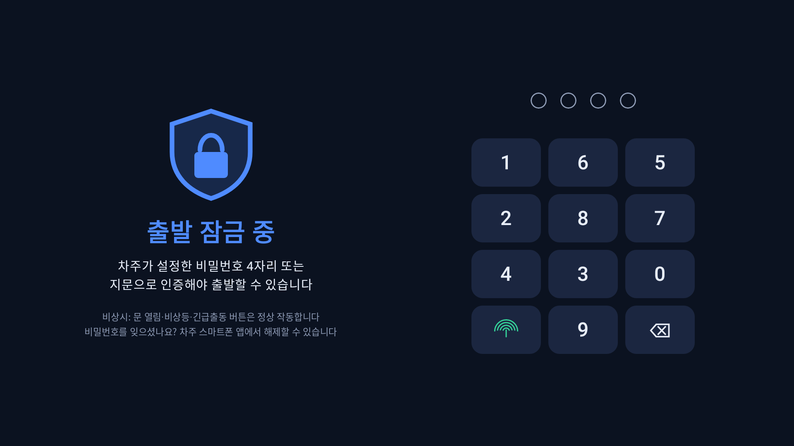
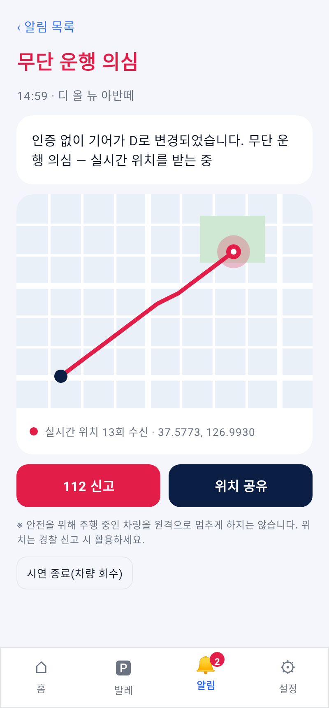
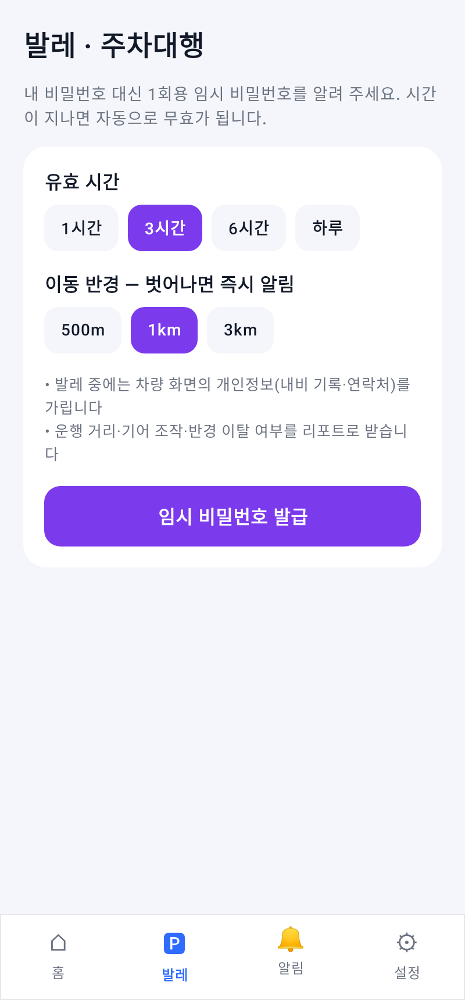

# KEEPER (키퍼)

> **키가 있어도, 내 허락 없이는 출발할 수 없는 차**
> Pleos Connect 차량용 출발 잠금(도난 방지) 앱 · 현대자동차그룹 차량용 앱 개발 공모전 출품작

스마트키가 차 안에 있어도, 차주가 정한 **비밀번호 4자리나 지문으로 인증해야만 출발**할 수 있게 합니다.
발레·대리주차 때는 **시간·반경이 제한된 1회용 임시 비밀번호**를 발급하고, 인증 없이 출발하면 **차주 스마트폰으로 즉시 알림과 실시간 위치**를 보냅니다.

<p align="center">
  
  
  
</p>

## 왜 필요한가

- 국내 자동차 절도는 최근 5년 연평균 약 2,650건(2017~2021, 경찰청)입니다.
- 해외 통계에서는 도난의 상당수가 **키가 이미 차 안에 있던 경우**입니다. 미국에서는 2013~2018년 37.7만 대가 키를 둔 채 도난됐고(NICB), 캐나다 사스캐치원에서는 2021년 도난 차량의 29%가 그런 경우였습니다(RCMP).
- 발레·정비·장기 주차처럼 **키가 남의 손에 있는 순간**에는 차를 지킬 수단이 없습니다.

## 주요 기능

| 기능 | 동작 | 사용하는 차량 신호 |
|---|---|---|
| 출발 잠금 | 도난방지모드 중 운전석 착석·브레이크가 감지되면 잠금 화면 표시. 비밀번호 4자리(매번 무작위 배열) 또는 지문으로 해제 | 운전석 착석, 브레이크 |
| 3회 오류 경보 | 입력 제한(30초부터 점점 증가) + 차주 알림 + 주차 중에만 실내등·앰비언트 경고 | 실내등, 앰비언트 라이트 |
| 원격 켜기·끄기 | 폰 앱으로 켜면 전체 문 잠금 + 출발 잠금 대기, 하차 시 자동 재잠금 | 도어 잠금, 기어, 착석 |
| 발레 임시 비밀번호 | 유효시간·이동 반경 설정, 반경 이탈 알림, 종료 후 운행 리포트 | 위치(반경 알림), 기어 |
| 무단 운행 감지 | 인증 없이 기어가 P에서 바뀌면 차주에게 알림 + 실시간 위치 | 기어, 차속, 위치 |
| 가족 운전자 | 가족별 비밀번호, 운행 시작 시 차주 알림 | 착석, 인증 기록 |

## 안전 원칙

- **주행 중에는 절대 새로 잠그지 않습니다.** 원격으로 켜도 다음 주차(P단 + 운전석 하차) 때 적용합니다.
- 달리는 차를 멈추게 하는 제어는 하지 않습니다. 무단 운행 시에는 알림·위치 추적·음성 안내만 합니다.
- 인증은 차량 안에서 처리해 통신이 끊기는 지하 주차장에서도 동작합니다.
- 비밀번호는 원문 없이 해시로만 저장하고, 0000·1234 같은 쉬운 번호는 등록할 수 없습니다.
- 문 열림·비상등·긴급출동 버튼은 항상 정상 작동합니다.

## 프로젝트 구성

```
core/   출발 잠금 판단 엔진 (순수 Kotlin, 단위 테스트 11건)
car/    Pleos Connect 차량 앱 (Kotlin · Jetpack Compose)
phone/  차주 스마트폰 앱 (Kotlin · Jetpack Compose)
```

## 사용한 Pleos SDK / API

| SDK | API | 용도 |
|---|---|---|
| Vehicle 2.3.2 | `Seat.registerSeatOccupancy` | 운전석 착석 → 인증 화면 |
| Vehicle 2.3.2 | `Brake.registerBrakePedalStatus` | 출발 의도 감지 |
| Vehicle 2.3.2 / AAOS | Gear 선택 상태, `CarPropertyManager` (`GEAR_SELECTION`, `PERF_VEHICLE_SPEED`) | 무단 운행 판단, 주행 중 잠금 금지 |
| Vehicle 2.3.2 | `Door.registerDoorLockState`, `setDoorLock` | 원격 켜기 시 문 잠금 |
| Vehicle 2.3.2 | `Light.setCabinLightSwitch`, `setAmbientLight…` | 주차 중 경고 조명 |
| FusedLocation 1.1.3 | `registerFusedLocationCallback`, `addProximityAlert(EXIT)` | 위치 추적, 발레 반경 이탈 |
| Android | `BiometricPrompt`, `TextToSpeech` | 지문 인증, 음성 안내 |

## 빌드와 실행

요구 사항: Android Studio, JDK 17, Android SDK 35

```bash
./gradlew :core:test            # 판단 엔진 단위 테스트
./gradlew :car:assembleRelease  # 차량 앱 APK
./gradlew :phone:assembleRelease
```

- Pleos 차량 또는 Pleos 에뮬레이터에서는 실제 차량 신호를 사용합니다.
- Pleos Vehicle Service가 없는 일반 안드로이드 기기에서는 자동으로 **시연 모드**로 실행되어, 화면의 시연 패널로 착석·브레이크·기어 신호를 바꿔 보며 모든 기능을 확인할 수 있습니다.
- `keystore/`의 서명 키는 시연용입니다.

## 한계와 향후 계획

현재 공개 SDK로는 앱이 시동·변속을 직접 막을 수 없어, 지금 버전은 **잠금 화면 + 감지 + 알림·위치 추적** 방식입니다.
현대차의 차량 '출발 허가(이모빌라이저)' 신호와 연동하면, 인증 전에는 P단 해제 자체를 막는 완전한 출발 잠금으로 확장할 수 있습니다.
